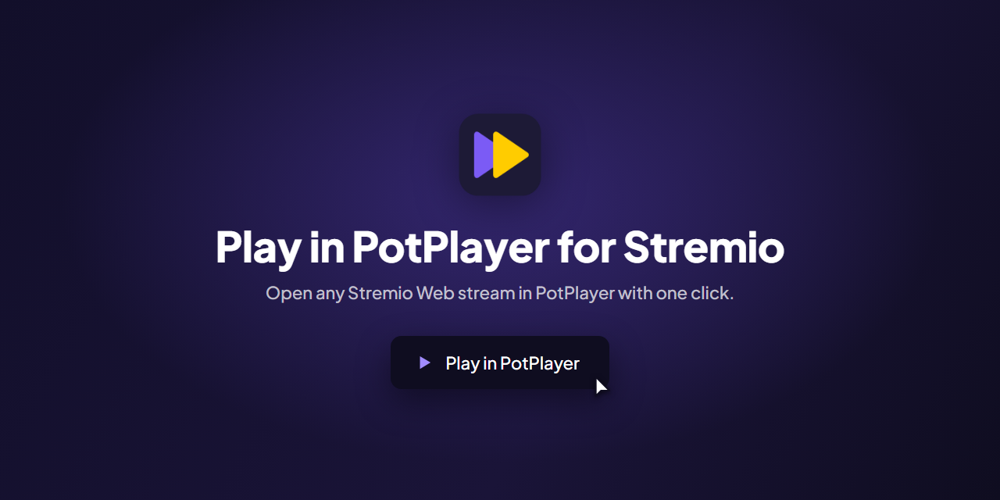

> Unofficial project. Not affiliated with, endorsed by, or sponsored by Stremio or PotPlayer.

Play any Stremio Web stream in PotPlayer with one click. Optionally, bring the subtitles from your Stremio subtitle add-ons along too.

## Requirements

- Windows
- [PotPlayer](https://potplayer.tv/) (64-bit, up to date)
- Google Chrome, or another Chromium browser such as Edge or Brave
- [Stremio Service](https://www.stremio.com/download-service), only for torrent streams

## Install

1. Download `play-in-potplayer-for-stremio.zip` from the [latest release](https://github.com/abdallah28r/play-in-potplayer-for-stremio/releases/latest).
2. Unzip it to a folder you will keep. Chrome loads the extension from this folder, so don't delete or move it.
3. Optional: if you want the subtitles from your Stremio add-ons with the video, see [Subtitles](#subtitles) after step 6.
4. Open `chrome://extensions` in Chrome.
5. Turn on **Developer mode** (top right).
6. Click **Load unpacked** and select the unzipped folder.

If Stremio Web is already open, reload it with `F5`.

## Use

1. Open a movie or episode on [web.stremio.com](https://web.stremio.com).
2. **Right-click** a stream in the list.
3. Click **Play in PotPlayer**.
4. The first time, Chrome asks to open PotPlayer. Tick **Always allow** and click **Open**.

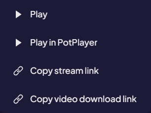

Works with Stremio Web 5 (5.0 beta and 5.1) on `web.stremio.com`. `web.strem.io` and the old Stremio 4 web app (`app.strem.io/shell-v4.4`) are not supported.

## Subtitles

A link can only carry the video, so subtitles from your Stremio subtitle add-ons (such as OpenSubtitles or SubDL) do not reach PotPlayer by default. To bring them along, install the small subtitles helper once:

1. Open the `subtitles-helper` folder inside the extension folder. Keep it where it is.
2. Double-click `install.bat`. No admin rights are needed. If Windows warns about it, click **Run** only if you downloaded the extension from this repository's [Releases page](https://github.com/abdallah28r/play-in-potplayer-for-stremio/releases).
3. Reload Stremio Web with `F5`.

From then on, PotPlayer opens with all the subtitles your add-ons have in your **Default Subtitles Language** (set in Stremio's settings), in the same order as your add-ons in Stremio. If none is found, the video opens without subtitles.

It works with any subtitle add-on that works in Stremio Web. SRT, WebVTT, ASS/SSA, SMI and SUB files are supported, also inside `.gz` or `.zip` files.

Switch between subtitles in PotPlayer with `Alt+L`, or right-click the video and open **Subtitles**. If one is out of sync, try the next.

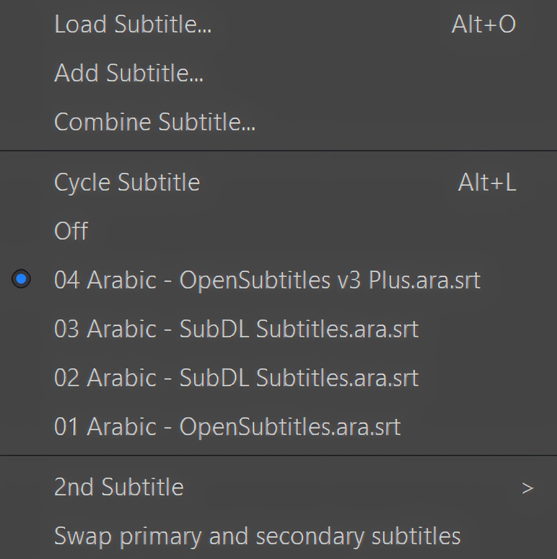

To remove the helper, double-click `uninstall.bat`.

The helper is a short PowerShell script (`subtitles-helper/host.ps1`) you can read. It only runs when you click **Play in PotPlayer**, downloads the chosen subtitle files to your temp folder, and starts PotPlayer with them.

## Settings

Click the extension's icon in Chrome's toolbar to open its settings. If you don't see the icon, click the puzzle-piece icon first, then the extension.

**Supported sites:** the extension works on `web.stremio.com`. If you open Stremio Web at another address, for example your own copy of it, add that address here. Chrome asks you to allow each one. Reload that site's tab with `F5` afterwards.

## Messages

The extension tells you what happened in a small message on the page.

| Message | Meaning |
| --- | --- |
| 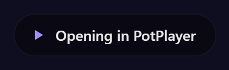 | The link was sent to PotPlayer. |
| 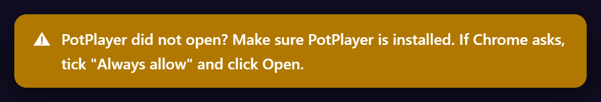 | The page stayed in front, so PotPlayer may not have opened. |
| 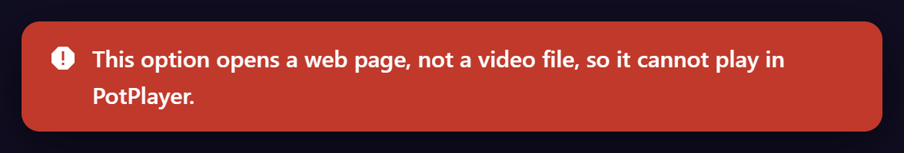 | This stream cannot play in PotPlayer. The message gives the reason. |
| 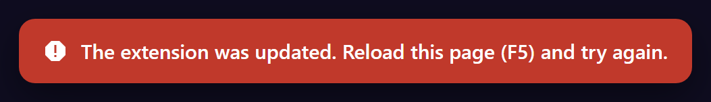 | The extension was updated while Stremio Web was open. Press `F5`. |

With the [subtitles helper](#subtitles) installed, you may also see:

| Message | Meaning |
| --- | --- |
| 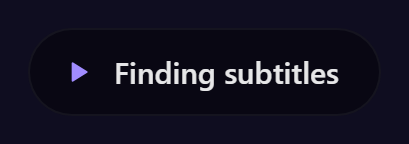 | Asking your subtitle add-ons. This can take a few seconds. |
| 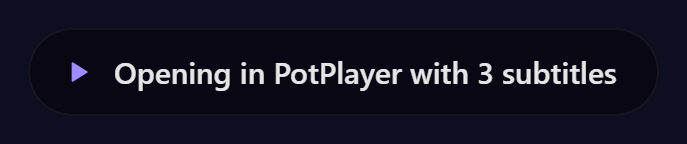 | PotPlayer opens with this many subtitles. Switch between them with `Alt+L`. |
| 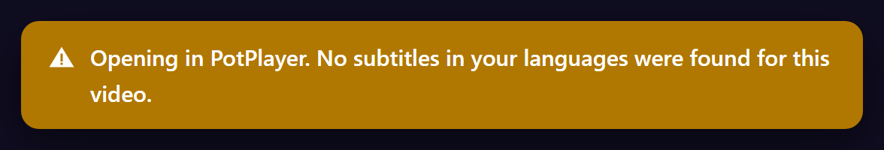 | None of your add-ons has a subtitle in your language for this video. |
| 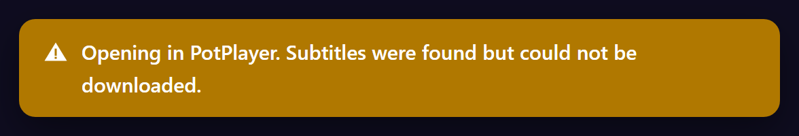 | The video opens without them. Try again later. |
| 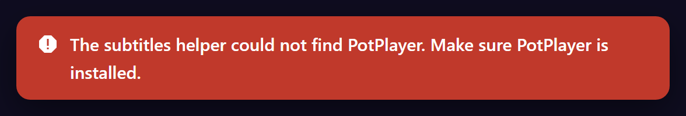 | Install PotPlayer (64-bit). |

## Troubleshooting

| Problem | Fix |
| --- | --- |
| The option is not in the menu | Reload Stremio with `F5`. Right-click the stream (a left click plays it inside Stremio). If you use another address than `web.stremio.com`, add it in the [settings](#settings). `web.strem.io` and the old Stremio 4 web app (`app.strem.io`) are not supported. |
| Nothing happens when I click it | Check that PotPlayer is installed and up to date. If you declined Chrome's prompt, reload the page and accept it. |
| PotPlayer opens but the video fails | The link may have expired. Open it again from Stremio or try another stream. |
| "This link is too long to open directly…" | If the message says it was copied, press `Ctrl+U` in PotPlayer and paste it. Otherwise, use **Copy stream link** first. |
| "This stream needs Stremio Service…" | Install and start [Stremio Service](https://www.stremio.com/download-service), then try again. |
| No subtitles in PotPlayer | <ul><li>Run `install.bat` again if you moved the folder.</li><li>Check that a subtitle add-on is installed in Stremio.</li><li>Check that **Default Subtitles Language** is set in Stremio's settings.</li><li>Reload Stremio with `F5`.</li></ul> |

Streams that need custom connection headers may not play, because PotPlayer cannot receive headers through a link.

## Updating

- **From 1.2.0 or later:** unzip the new version over your current extension folder and replace the files. Click the reload icon on the extension in `chrome://extensions`, then reload Stremio Web with `F5`. Your settings and the subtitles helper keep working.
- **From 1.1.0:** remove the old extension in `chrome://extensions` first, then load the new folder. Version 1.2.0 changed the extension ID, so Chrome would otherwise show the option twice.

All versions and changes are on the [Releases page](https://github.com/abdallah28r/play-in-potplayer-for-stremio/releases).

**Update notices:** from 1.3.0, a small notice appears at the bottom of Stremio Web when a new version is out, with a **Download** button. It shows on two different days at most. After you install or update, a short **What's new** notice shows once. Notices are in Arabic when Stremio's language is Arabic, and in English otherwise.

## Privacy

- No accounts, analytics, or tracking. The extension has no server and collects nothing.
- It runs only on Stremio Web and on addresses you add in the settings. The stream link goes only to PotPlayer on your PC, and to Stremio's local streaming server (`127.0.0.1:11470`) when a stream needs it.
- For update notices, it checks GitHub for the latest release at most every 12 hours. The request contains nothing about you or what you watch.
- With the subtitles helper, it asks your installed subtitle add-ons for subtitles, sending the same details Stremio's own player sends (the title ID and the video file name), then downloads the files they return. Nothing else is sent.
- Stream links can contain private tokens from your add-ons. PotPlayer may show them in its title bar and history, so take care when sharing screenshots.

## Legal

This project is a small launcher. It does not host, provide, index, or link to any media, and it includes no add-ons, stream sources or subtitle sources. Subtitles come only from the subtitle add-ons you installed in Stremio. It does not bypass DRM or any other copy protection.

You are responsible for what you watch and for following the laws of your country and the terms of the services you use. Only play content you have the right to access.

Stremio, PotPlayer, OpenSubtitles and SubDL are trademarks of their respective owners and are named here only to describe compatibility.

## Acknowledgements

The request used to start streams on Stremio's local server follows the format used by [stremio-video](https://github.com/Stremio/stremio-video) (MIT License).

## License

[MIT](LICENSE)
