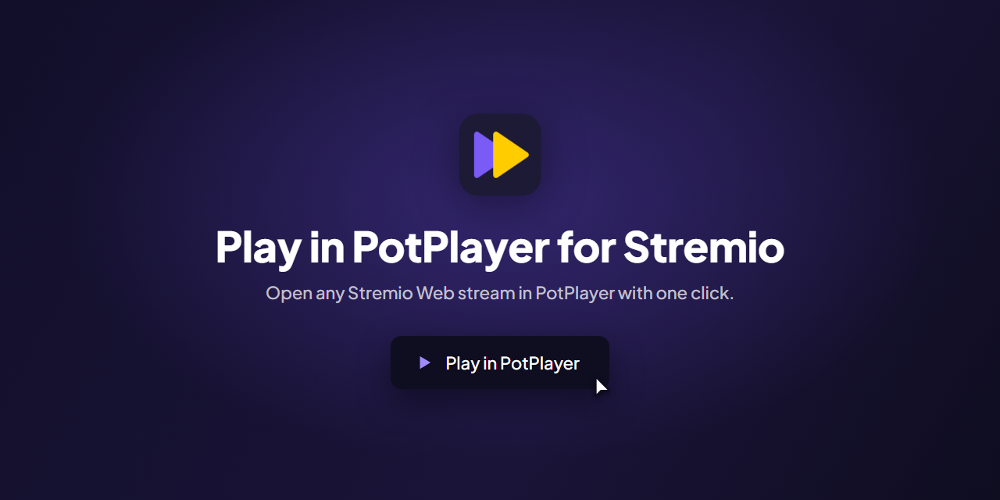
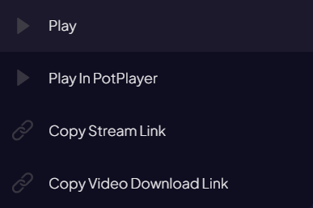
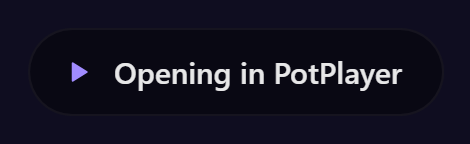
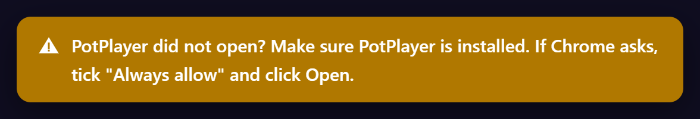
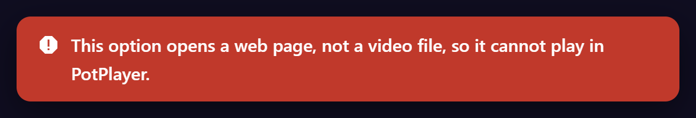

Play any Stremio Web stream in PotPlayer with one click. Optionally, bring the subtitles from your Stremio subtitle add-ons along too.

## Requirements

- Windows
- [PotPlayer](https://potplayer.tv/) (64-bit, up to date)
- Google Chrome, or another Chromium browser such as Edge or Brave

## Install

1. Download `play-in-potplayer-for-stremio.zip` from the [latest release](https://github.com/abdallah28r/play-in-potplayer-for-stremio/releases/latest).
2. Unzip it to a folder you will keep. Chrome loads the extension from this folder, so don't delete or move it. The `subtitles-helper` folder inside is optional: leave it there, you can ignore it.
3. Open `chrome://extensions` in Chrome.
4. Turn on **Developer mode** (top right).
5. Click **Load unpacked** and select the unzipped folder.

If Stremio Web is already open, reload the page with `F5`.

**Updating from version 1.1.0:** remove the old extension in `chrome://extensions` first, then load the new folder. Version 1.2.0 has a new extension ID, so Chrome treats it as a different extension and you would see the option twice.

## Use

This Chrome extension adds a **Play in PotPlayer** option to the right-click menu of streams on [web.stremio.com](https://web.stremio.com). Nothing else to install or configure. Subtitles are an optional extra, described below.

1. Open a movie or episode on [web.stremio.com](https://web.stremio.com).
2. **Right-click** a stream in the list.
3. Click **Play in PotPlayer**.

The first time, Chrome asks to open PotPlayer. Tick **Always allow** and click **Open**.

## Subtitles (optional)

A link can only carry the video, so subtitles from your Stremio subtitle add-ons (such as OpenSubtitles or SubDL) do not reach PotPlayer by default. To bring them along, install the small subtitles helper once:

1. Open the `subtitles-helper` folder inside the extension folder. Keep it where it is.
2. Double-click `install.bat`. No admin rights are needed. If Windows asks whether to run it, click **Run**.
3. Reload Stremio Web with `F5`.

From then on, **Play in PotPlayer** asks your installed subtitle add-ons for subtitles, the same way Stremio's own player does, and opens PotPlayer with all of them in your **Default Subtitles Language** (set in Stremio's settings). There is no limit on how many. They are listed add-on by add-on, in the order of your add-ons in Stremio, and each add-on's subtitles keep the order the add-on gives them (usually best first). If none is in your language, the video opens without subtitles.

It works with any subtitle add-on that works in Stremio Web. Subtitle files in SRT, WebVTT, ASS/SSA, SMI and SUB are supported, also inside `.gz` or `.zip` files. WebVTT files are converted to SRT, which PotPlayer reads best.

Switch between subtitles in PotPlayer with `Alt+L`. If one is out of sync, try the next.

To remove the helper, double-click `uninstall.bat`. The extension then goes back to opening videos without subtitles.

The helper is a short PowerShell script (`subtitles-helper/host.ps1`) you can read. It only runs when you click **Play in PotPlayer**. It downloads the chosen subtitle files to your temp folder and starts PotPlayer with them.

## Messages

The extension tells you what happened in a small message on the page.

| Message | Meaning |
| --- | --- |
|  | The link was sent to PotPlayer. |
|  | The page stayed in front, so PotPlayer may not have opened. |
|  | This stream cannot play in PotPlayer. The message gives the reason. |

With the subtitles helper installed, you also see **Finding subtitles**, then **Opening in PotPlayer with N subtitles**, or a note when no subtitles in your language were found.

## Troubleshooting

| Problem | Fix |
| --- | --- |
| The option is not in the menu | Reload Stremio with `F5`. Make sure you right-clicked a stream, because a left click plays it inside Stremio. |
| Nothing happens when I click it | Check that PotPlayer is installed and up to date, then try again. If you declined Chrome's prompt, reload the page and accept it. |
| PotPlayer opens but the video fails | The link may have expired, so open it again from Stremio or try another stream. |
| "Link is too long" message | The link was copied for you. Press `Ctrl+U` in PotPlayer and paste it. |
| "Needs Stremio Service" message | Install and start [Stremio Service](https://www.stremio.com/download-service), then try again. |
| No subtitles in PotPlayer | Run `subtitles-helper/install.bat` again (needed after moving the folder), reload Stremio with `F5`, and check that a subtitle add-on is installed in Stremio and that **Default Subtitles Language** is set in Stremio's settings. |

Streams that need custom connection headers may not play, because PotPlayer cannot receive headers through a link.

## Privacy

- No accounts, analytics, or tracking. The extension has no server and collects nothing.
- It runs only on Stremio Web. The stream link is sent only to PotPlayer on your PC, and to Stremio's local streaming server (`127.0.0.1:11470`) when a stream needs it.
- With the subtitles helper installed, the extension asks the subtitle add-ons you installed in Stremio for subtitles. It sends them the same details Stremio's own player sends (the title ID and the video file name). The helper then downloads the subtitle files from the links those add-ons return. Nothing else is sent anywhere.
- Stream links can contain private tokens from your add-ons. PotPlayer may show them in its title bar and keep them in its history, so take care when sharing screenshots.

## Legal

This project is a small launcher. It does not host, provide, index, or link to any media, and it includes no add-ons or stream sources. It does not bypass DRM or any other copy protection.

You are responsible for what you watch and for following the laws of your country and the terms of the services you use. Only play content you have the right to access.

Stremio and PotPlayer are trademarks of their respective owners and are named here only to describe compatibility.

## Acknowledgements

The request used to start streams on Stremio's local server follows the format used by [stremio-video](https://github.com/Stremio/stremio-video) (MIT License).

## License

[MIT](LICENSE)

> Unofficial project. Not affiliated with, endorsed by, or sponsored by Stremio or PotPlayer
